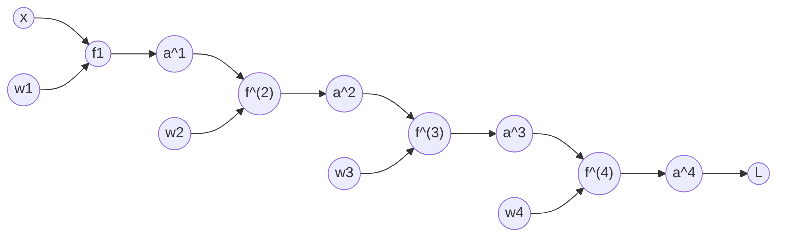

# BackProp Algorithm  

General concept : Find how a particular weight in any given layer influences the loss.

General how : use the chain rule to calculate the partial derivative of each function with respect to the function right before it. Propagate that derivative backwards to get to a certain weight. 

Let's draw a graph and define a few concepts.  

The graph above represents the operation flow of a neural network containing only linear functions. 

The goal of backprop is to end up with all the gradients, which is basically the partial derivative of the Loss with respect to each weight. 

For a given neural network with `n` layers, the gradient set is:  

$\nabla W = \frac{\partial L}{\partial W} = \{\frac{\partial L}{\partial w1},\frac{\partial L}{\partial w2}, ..., \frac{\partial L}{\partial w_n}\}$

For any given partial derivative with respect to the weight, we need to use the chain rule to deconstruct derivative into direct connections. For example to calculate the partial derivative of the Loss with respect to weigth 4 in our graph above, we must first find the partial derivatives with respect to what it inherited. So we need to find the partial derivative of L with respect to a4, the partial derivate of a4 with respect to f4, and finally, the partial derivative of f4 with respect to w2.  

Starting at the weight closest to the Loss (in this case weight 4), the gradients are: 

$\frac{\partial L}{\partial w_4} = \frac{\partial L}{\partial a_4}*\frac{\partial a_4}{\partial f_4}*\frac{\partial f_4}{\partial w_4}$  

$\frac{\partial L}{\partial w_3} = \frac{\partial L}{\partial a_4}*\frac{\partial a_4}{\partial f_4}*\frac{\partial f_4}{\partial a_3}*\frac{\partial a_3}{\partial f_3}*\frac{\partial f_3}{\partial w_3}$  

$\frac{\partial L}{\partial w_3} = \frac{\partial L}{\partial a_4}*\frac{\partial a_4}{\partial f_4}*\frac{\partial f_4}{\partial a_3}*\frac{\partial a_3}{\partial f_3}*\frac{\partial f_3}{\partial a_2}*\frac{\partial a_2}{\partial f_2}*\frac{\partial f_2}{\partial w_2}$  

$\frac{\partial L}{\partial w_3} = \frac{\partial L}{\partial a_4}*\frac{\partial a_4}{\partial f_4}*\frac{\partial f_4}{\partial a_3}*\frac{\partial a_3}{\partial f_3}*\frac{\partial f_3}{\partial a_2}*\frac{\partial a_2}{\partial f_2}*\frac{\partial f_2}{\partial a_1}*\frac{\partial a_1}{\partial f_1}*\frac{\partial f_1}{\partial w_1}$  

A lot of the computation is repeated, which in coding, we can just send over to the previous layer, hence why it is called backwards propagation (cause the product is propagated backwards). 

Each term in the equation is what we need to find in order to compute the gradient. Each layer will do its own calculation, and whatever computations are needed in the earlier layers will be propagated backwards. 

Here's a list of operations and what their partial derivative can be in computation.  

<u> Dot Product </u>  

This is basically the Linear transformation in the linear layer.  

Recall  
$z = Wx$   
NOTE: in my code, the shape of my matrix is (out, in), that way, i dont need to transpose the W.  

$$\frac{f_n}{a_{n-1}} = \frac{\partial z}{\partial x} = W$$ 

$$\frac{f_n}{w_n} = \frac{\partial z}{\partial W} = x$$ 

The z is the output of the operation.  
The x is the input of the operation. In a given linear layer, the x would be the output of the previous layer.  

<u> ReLU </u>  

Recall  
$$h(z) = \{x \space if \space x > 0; 0 \space otherwise\}$$

So the partial would be: 
$$\frac{\partial a_n}{f_{n-1}} = \{0 \space if \space input \space < 0 ; 1 \space otherwise\}$$

important to understand that the input is the input of the layer. So basically the ouput of the previous layer. 

<u> Softmax + CCE </u>  

Softmax is combined with CCE to make the calc easier. this restricts the user to use softmax with CCE only.

$$\frac{\partial L}{\partial z} = \hat{y} - y$$

The z is the input of the softmax layer. Therefore we can start the backprop directly at the softmax layer instead of the CCE layer. 

